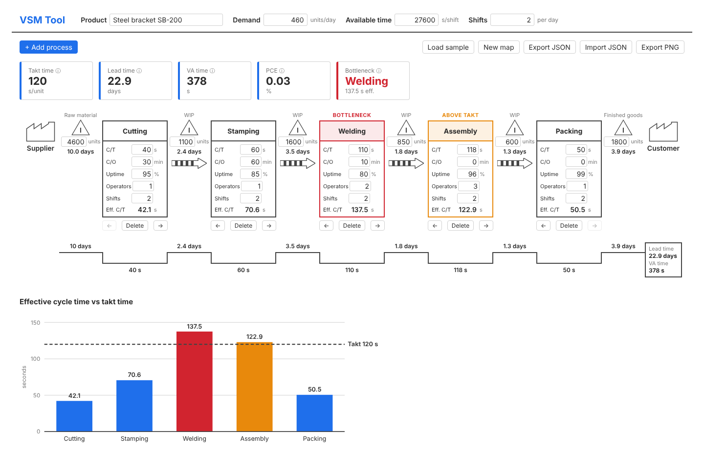
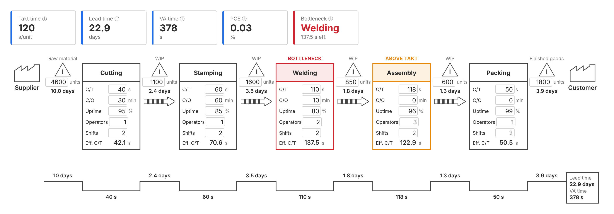

# VSM Tool

**Live demo: [vsm-tool-five.vercel.app](https://vsm-tool-five.vercel.app)**

A web app for building **Value Stream Maps** and automatically calculating the key lean metrics:
takt time, production lead time, value-added time, process cycle efficiency and the bottleneck.

Built as a portfolio project during my MSc in Production Engineering and Management at KTH.



## Features

- **Map editor** in classic VSM style: supplier, process boxes with data boxes
  (C/T, C/O, uptime, operators, shifts), inventory triangles, push arrows and customer
- **Inline editing** of every value, plus add, delete and reorder (move left/right) processes
- **Input validation**: no negative numbers, uptime between 1 and 100 %
- **Metrics panel**: takt time, lead time, value-added time, PCE and bottleneck,
  with the formula behind each metric shown on hover
- **Warnings on the map**: the bottleneck is highlighted in red, processes slower than takt in orange
- **VSM timeline (ladder)** aligned with the map, with lead time and VA time totals
- **Bar chart** of effective cycle time per process against the takt time line (plain SVG)
- **Auto-save** to the browser's localStorage
- **Import / export** of maps as JSON, and **PNG export** of the metrics, map and timeline
- **Sample map** of a five-process line to explore right away

### PNG export



## Formulas

All calculations are pure functions in `src/lib/vsmCalculations.js` and are covered by unit tests.
Times are in seconds, inventory in units and lead time in days.

- **Available time per day** = available time per shift × shifts per day
- **Takt time** (s/unit) = available time per day ÷ customer demand per day
- **Effective cycle time** (s) = cycle time ÷ (uptime / 100)
- **Days of inventory** = inventory quantity ÷ customer demand per day
- **Production lead time** (days) = sum of the days of inventory of every inventory:
  raw material, each inventory between processes, and finished goods
- **Value-added time** (s) = sum of the cycle times of all processes
- **Process cycle efficiency** (%) = value-added time ÷ (production lead time × available time per day) × 100
- **Bottleneck** = the process with the highest effective cycle time
- **Process above takt** = a process whose effective cycle time is greater than the takt time

Example with the sample map: 27 600 s × 2 shifts ÷ 460 units/day gives a takt time of 120 s.
Welding (110 s at 80 % uptime = 137.5 s) is the bottleneck, and Assembly
(118 s at 96 % uptime ≈ 122.9 s) is also above takt.

## Assumptions

- **Lead time in working time**: to calculate PCE, lead time is converted from days to seconds
  using the available working time per day (e.g. 2 × 27 600 s), not 24 hours.
  Value-added time and lead time are therefore both measured in working time.
- **Effective cycle time is based on uptime only**: downtime is spread over every unit
  (C/T ÷ uptime). Changeover time is shown on the map but is not added to the effective cycle time.
- **Bottleneck tie rule**: if several processes share the highest effective cycle time,
  the first one in the flow (the most upstream) is reported as the bottleneck.
- **Value-added time** counts the full cycle time of every process as value-adding.

## Run locally

Requires [Node.js](https://nodejs.org/) 18 or newer.

```bash
git clone https://github.com/CharilaosStavrou/vsm-tool.git
cd vsm-tool
npm install
npm run dev       # start the dev server at http://localhost:5173
npm test          # run the unit tests (Vitest)
npm run build     # production build in dist/
```

## Deploy

The app is a static site with no backend, so any static host works.

**Vercel** (configured in `vercel.json`):

1. Push the repository to GitHub.
2. In Vercel, choose **Add New → Project** and import the GitHub repository.
3. Keep the detected settings (framework **Vite**, build command `npm run build`,
   output directory `dist`) and click **Deploy**.

Every push to `main` then deploys automatically.

**GitHub Pages**: build with the repository name as base path, e.g.
`npm run build -- --base=/vsm-tool/`, and publish the `dist/` folder.

## Tech stack

- [React](https://react.dev/) + [Vite](https://vite.dev/), JavaScript
- Plain CSS: one global stylesheet with CSS variables
- [html-to-image](https://github.com/bubkoo/html-to-image) for PNG export
- [Vitest](https://vitest.dev/) for unit tests
- No backend: state in React, saved to localStorage and JSON files

## Project structure

```
src/
  components/   React components (map, process box, timeline, chart, ...)
  data/         Sample value stream
  lib/          Data model, state updates, calculations, storage and export
```

## Future improvements

- **Future-state map**: a second map next to the current state to compare improvements
- **Kaizen bursts**: mark improvement opportunities directly on the map
- **Pull and supermarket symbols**: model kanban loops and FIFO lanes, not only push flow
- **Shipment arrows**: truck shipments from the supplier and to the customer, with delivery frequency

## License

[MIT](LICENSE)
